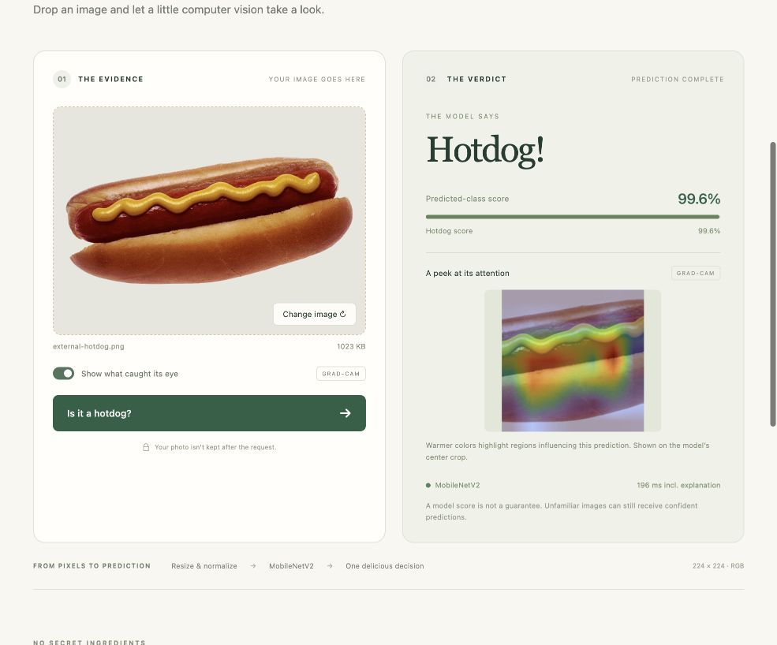
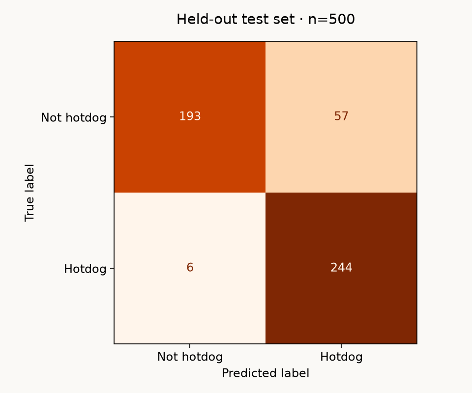
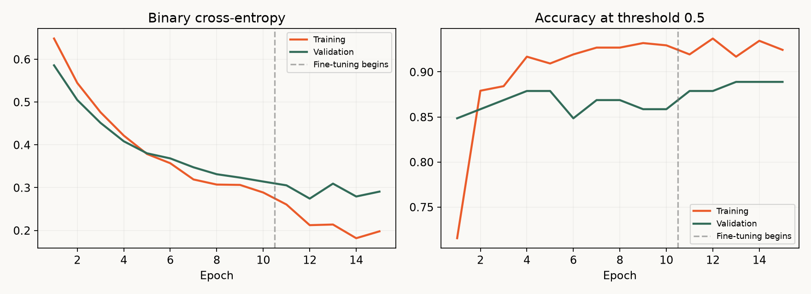

# SeeFood 🌭

**Hotdog or not hotdog?** An end-to-end binary image classifier with a trained MobileNetV2, FastAPI backend, responsive upload interface, Grad-CAM explanations, and reproducible evaluation.

This repository contains the actual trained weights and reports. No API keys, paid prediction services, or dataset download are needed to run the application.



Screenshot example: [Hot dog with mustard](https://commons.wikimedia.org/wiki/File:Hot_dog_with_mustard.png), Czar / original photo Renee Comet, public domain / CC0. It is an outside-dataset smoke check, not part of the measured test accuracy.

## Run the application

Use **Python 3.12**. Run these commands from the repository root:

```bash
git clone https://github.com/AyushPatra45/SeeFood.git
cd SeeFood
python3.12 -m venv .venv
source .venv/bin/activate
python -m pip install -r requirements.txt
python -m uvicorn api.main:app --host 127.0.0.1 --port 8000
```

Windows activation: `.venv\Scripts\activate`. If Python 3.12 is your default interpreter, use `python` in place of `python3.12`.

Open **http://127.0.0.1:8000**. Upload a JPEG, PNG, or WebP image, optionally enable Grad-CAM, then click **Is it a hotdog?** The interface includes loading, error, unavailable-model, and close-call states. API documentation is at **http://127.0.0.1:8000/docs**.

The server loads the model once and runs inference on CPU, so a GPU is not needed. Uploads are limited to 8 MiB and 16 megapixels. Image content is decoded and checked, not trusted based on its filename. The application does not retain uploads; the multipart library may temporarily spool larger uploads to disk before the file is closed at request completion.

### Download trained weights directly

- [PyTorch checkpoint](https://github.com/AyushPatra45/SeeFood/raw/refs/heads/main/artifacts/model.pt) — the application's default.
- [FP32 ONNX model](https://github.com/AyushPatra45/SeeFood/raw/refs/heads/main/artifacts/model.onnx).
- [INT8 ONNX model](https://github.com/AyushPatra45/SeeFood/raw/refs/heads/main/artifacts/model.int8.onnx).
- [Checkpoint metadata](artifacts/metadata.json) — preprocessing size, class mapping, threshold, training configuration, and selected epoch.

These downloadable weights satisfy the assignment's **live demo OR saved weights** submission option. GitHub Pages cannot run this Python API. Public hosting is optional; Docker deployment instructions are below.

## Results: the held-out test set

The saved model and validation-selected threshold **0.15** produce:

| Metric | Value |
|---|---:|
| Test images | 500 |
| Accuracy | **87.4%** |
| Precision, hotdog positive | **81.06%** |
| Recall, hotdog positive | **97.6%** |
| F1 | **88.57%** |
| True negatives / false positives | 193 / 57 |
| False negatives / true positives | 6 / 244 |





The 95% Wilson interval for test accuracy is approximately **84.2–90.0%**, under the usual independent-sample assumption; correlated or noisy images limit that interpretation. Full numbers and the exact checkpoint hash are in [metrics.json](reports/metrics.json). Predictions for every test image are in [test_predictions.json](reports/test_predictions.json).

**A useful threshold lesson:** maximizing validation F1 on only 99 images selected 0.15, which favors recall. The conventional 0.5 baseline reached 91.4% accuracy and 90.83% F1 on this test set, with lower recall (85.2%). Both operating points are reported transparently. We retained the validation-selected threshold instead of choosing a threshold after seeing test labels. This is evidence that threshold tuning can overfit a small validation set, not evidence that lower thresholds always help.

## Reproduce training

The source is [Kaggle: Hot Dog – Not Hot Dog, by Dan Becker](https://www.kaggle.com/datasets/dansbecker/hot-dog-not-hot-dog). Follow the dataset's own usage and attribution terms. Raw images and archives are excluded from Git.

```bash
# Public Kaggle download; no credentials are written into the repository.
python scripts/download_data.py

# If direct download is blocked, download the ZIP from Kaggle manually:
# python scripts/download_data.py --archive /path/to/archive.zip

python -m seefood.prepare
python -m seefood.train --head-epochs 10 --finetune-epochs 12
python -m seefood.evaluate
```

Training automatically chooses CUDA, Apple MPS, or CPU. Use `--device cpu` to force CPU, or `--batch-size 16` if memory is constrained. Retraining overwrites the saved model and reports; rerun evaluation/export afterward and restart the API so all artifacts correspond to the same checkpoint.

### Data and leakage controls

The ZIP contains the corpus both at its root and inside `seefood/`. Preparation selects **one** train/test tree. It preserves the official **500-image test set**, detects exact decoded-image duplicates and near duplicates with 64-bit dHash distance ≤2, excludes two training images overlapping test groups, and splits remaining training groups using stratified group splitting with seed 42:

| Split | Hotdog | Not hotdog | Total |
|---|---:|---:|---:|
| Training | 199 | 198 | 397 |
| Validation | 50 | 49 | 99 |
| Test | 250 | 250 | 500 |

See [data_audit.json](reports/data_audit.json) and [manifest.json](reports/manifest.json). Validation is used for checkpoint and threshold selection; test data is not used for weight updates or selection. Perceptual hashing is a heuristic and does not guarantee all duplicates are found. Potential overlap between ImageNet pretraining and the target corpus has not been audited.

### Architecture and hyperparameters

```text
RGB image → resize shorter edge to 232 → center crop 224×224
          → tensor in [0,1] → ImageNet mean/std normalization
          → ImageNet-pretrained MobileNetV2 feature extractor
          → global average pooling → dropout(0.2) → Linear(1280,1)
          → logit → sigmoid → hotdog score → threshold decision
```

Torchvision `IMAGENET1K_V2` preprocessing uses mean `[0.485, 0.456, 0.406]` and standard deviation `[0.229, 0.224, 0.225]`. This is **PyTorch normalization**, not Keras MobileNet's −1 to 1 preprocessing. Evaluation, CLI inference, API inference, and ONNX calibration share the same deterministic transform.

- **Training augmentation:** random resized crop, horizontal flip, rotation up to 10°, and mild color jitter. Validation/test/inference do not use random augmentation.
- **Loss:** `BCEWithLogitsLoss`; combines sigmoid and binary cross-entropy stably. Labels are explicitly `not_hot_dog=0`, `hot_dog=1`; a sigmoid is applied only when interpreting scores.
- **Optimizer:** AdamW, batch size 32, weight decay `1e-4`.
- **Stage 1:** freeze every backbone parameter; train the 1,281-parameter head at learning rate `1e-3`, for up to 10 epochs.
- **Stage 2:** restore the best stage-1 checkpoint, unfreeze feature blocks 15–18 plus the head, and fine-tune 1,512,001 parameters at `1e-5`, for up to 12 epochs.
- **BatchNorm:** pretrained statistics and affine parameters remain frozen in both stages to avoid unstable updates from a small dataset.
- **Selection:** save the lowest validation-loss checkpoint across both stages; early-stop each stage after three epochs without meaningful validation-loss improvement.
- **Threshold:** grid 0.10–0.90 in increments of 0.01; maximize validation F1, breaking ties toward 0.5.

The final run completed 10 head epochs and 5 fine-tuning epochs, selecting fine-tuning epoch 2. An initial 6+6-epoch pilot was checked on validation only before the final run. Training used Apple MPS and seed 42; floating-point operations and augmentation can vary across devices, so exact scores are not guaranteed on a rerun. [history.json](reports/history.json) records actual epoch results.

### A real technical challenge

The initial data audit discovered the archive's duplicated folder tree and train/test duplicate groups. A naive recursive loader would count the corpus twice and could contaminate validation. The loader now selects one tree and uses duplicate groups to enforce separation.

Error review also found **apparent label noise**: for example, `test/hot_dog/160523.jpg` visually appears to contain a burger despite its hotdog label. We did not relabel or remove test images after evaluating. Two pizza images, `test/not_hot_dog/68684.jpg` and `72716.jpg`, were confidently misclassified as hotdogs; shared bread/cheese appearance may contribute, but that explanation is a hypothesis. [error_cases.json](reports/error_cases.json) records mistakes for further inspection.

## Inference and API

```bash
python -m seefood.predict /path/to/new-photo.jpg
python -m seefood.predict /path/to/new-photo.jpg --explain
# The second command writes gradcam.png in your current directory.

curl -X POST http://127.0.0.1:8000/predict \
  -F 'file=@/path/to/new-photo.jpg' -F 'explain=true'
```

The response contains `label`, `class_name`, `probability_hot_dog`, `confidence`, `threshold`, `uncertain`, `inference_ms`, and optionally a base64 PNG Grad-CAM overlay. `confidence` is the predicted class's sigmoid-derived score, not a calibrated guarantee. With a threshold other than 0.5, the selected class's score can be below 50%.

The close-call flag is set when `abs(p_hotdog - threshold) < 0.10` **or** binary entropy exceeds 0.50 nats (maximum possible is about 0.693). The response includes `binary_entropy_nats` and `uncertainty_reasons`. This is an ambiguity heuristic, **not reliable out-of-distribution detection** or probability calibration. Unfamiliar images may receive very confident wrong predictions. Grad-CAM targets the predicted class; its overlay aligns with the **224×224 crop the model actually sees**, not the full original image.

Two outside-dataset smoke checks are recorded in [external_inference.json](reports/external_inference.json). A public Wikimedia hotdog receives a 99.6% hotdog score. A Wikimedia cat receives a 27.6% hotdog score: the 0.15 operating threshold misclassifies it, but the entropy check flags it as uncertain. This failure is retained, not hidden. Neither image has a decoded-pixel match or near-dHash match to the manifest; this does not establish independence from pretraining.

| Endpoint | Purpose |
|---|---|
| `GET /health` | Model readiness |
| `GET /api/model` | Architecture, mapping, and decision threshold |
| `GET /api/metrics` | Actual held-out metrics |
| `GET /api/plots/{name}` | `confusion_matrix` or `training_curves` |
| `POST /predict` | Multipart image and optional `explain` boolean |
| `GET /docs` | Interactive OpenAPI documentation |

Invalid MIME types return 415, corrupt images 422, oversized uploads 413, and a missing model 503. A corrupt/incompatible checkpoint fails visibly at startup. Inference runs off the async event loop; a lock prevents simultaneous Grad-CAM hooks from interfering. The service is a demonstration application, not a hardened public upload service; public deployments should add reverse-proxy request limits and rate limiting.

## Bonus: ONNX and INT8 optimization

```bash
python -m pip install -r requirements-dev.txt
python -m seefood.export
```

Export checks the FP32 ONNX model against PyTorch on 20 validation images (maximum probability difference about `6.4e-7`). Static QDQ INT8 calibration uses up to 64 validation images, never test images. The fixed-threshold test evaluation measures the quantization tradeoff without retuning it.

| CPU ONNX Runtime, batch 1 | FP32 | INT8 |
|---|---:|---:|
| File size | 8,873,386 bytes | 2,650,420 bytes |
| Median model-only latency | 2.39 ms | 2.34 ms |
| Test accuracy at threshold 0.15 | 87.4% | 85.8% |

INT8 is **70.1% smaller**. The measured 1.02× speed ratio is small enough to be within normal benchmark variation; there is no meaningful guaranteed speedup. The accuracy reduction is why the application serves the original PyTorch model. Measurements use 10 warmups, 50 timed runs, four CPU threads, and exclude image decoding, preprocessing, networking, and Grad-CAM. See [optimization.json](reports/optimization.json) for platform details and complete metrics.

## Tests and deployment

```bash
python -m pip install -r requirements-dev.txt
python -m pytest -q
```

Tests cover split isolation, the archive's duplicate-tree issue, freeze/unfreeze behavior, shared preprocessing, grayscale/RGBA uploads, real checkpoint predictions, Grad-CAM and concurrent requests, invalid/oversized images, missing weights, and recomputation of saved metrics. They use the committed model and reports; no dataset download is needed. GitHub Actions runs the suite on pushes and pull requests. `requirements-lock-macos.txt` records the complete local environment; use the regular requirements files for portable setup.

To run the same application in Docker (port 7860, compatible with a Docker-based Hugging Face Space):

```bash
docker build -t seefood .
docker run --rm -p 7860:7860 seefood
```

Open http://localhost:7860. The Docker image serves CPU inference and includes saved weights and reports; it excludes raw data. No public hosted demo is claimed by this repository.

## Repository map

```text
seefood/       data transforms, model, preparation, training, evaluation, prediction, export
api/           FastAPI application
frontend/      responsive HTML/CSS/JavaScript interface
scripts/       public Kaggle download and safe extraction
artifacts/     trained checkpoint, metadata, FP32/INT8 ONNX
reports/       data audit, split manifest, predictions, metrics, curves, benchmarks
tests/         regression and integration checks
docs/          interview guide, requirement checklist, verification notes
```

Read [the interview guide](docs/INTERVIEW_GUIDE.md), [requirement checklist](docs/REQUIREMENTS.md), and [verification notes](docs/VERIFICATION.md) before presenting. Run the commands yourself and practise explaining each stage in your own words.

## References

- [Torchvision MobileNetV2 weights and preprocessing](https://docs.pytorch.org/vision/stable/models/generated/torchvision.models.mobilenet_v2.html)
- [PyTorch transfer-learning tutorial](https://docs.pytorch.org/tutorials/beginner/transfer_learning_tutorial.html)
- [FastAPI file uploads](https://fastapi.tiangolo.com/tutorial/request-files/)
- [scikit-learn classification metrics](https://scikit-learn.org/stable/modules/model_evaluation.html)
- [Grad-CAM paper](https://arxiv.org/abs/1610.02391)
- [ONNX Runtime quantization](https://onnxruntime.ai/docs/performance/model-optimizations/quantization.html)
